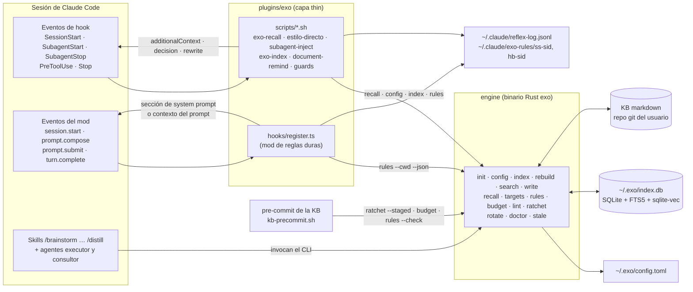
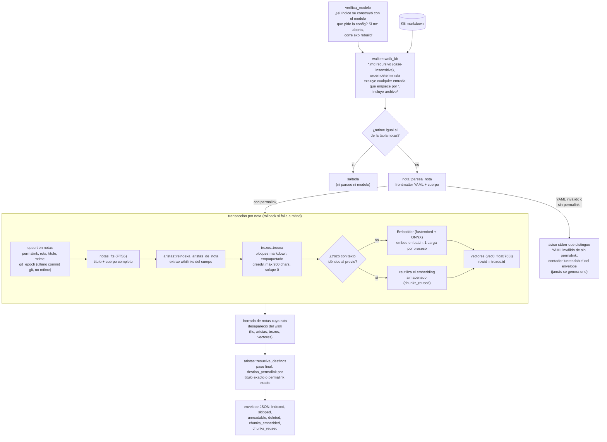
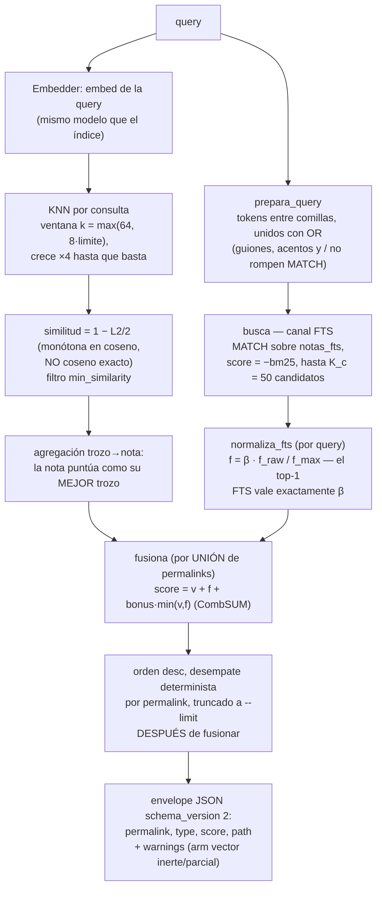
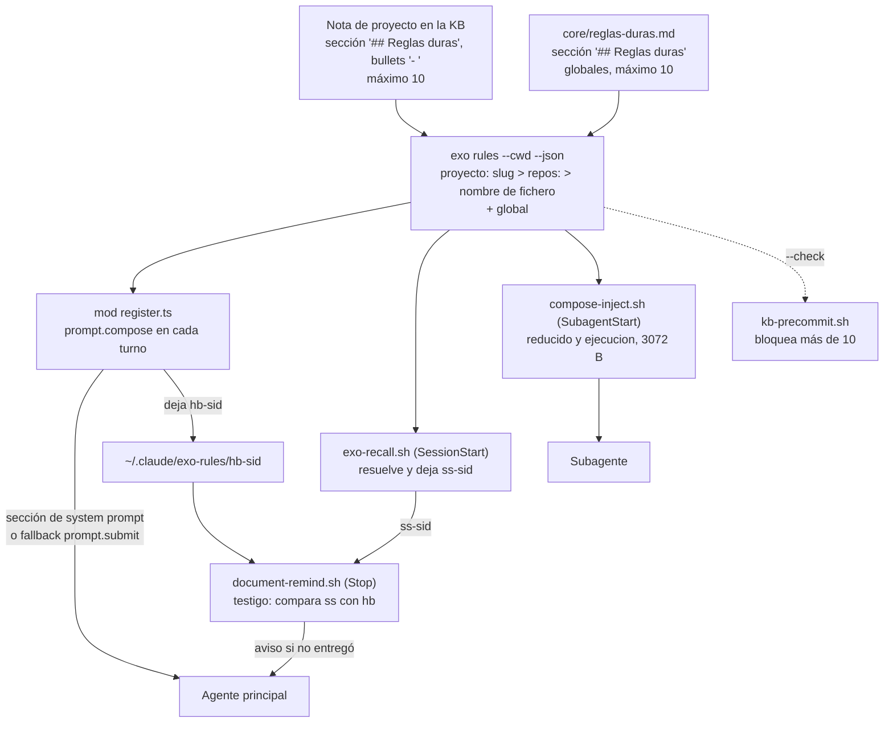

# Arquitectura de exo

> Este documento describe el sistema **tal como está implementado**, derivado
> de la lectura de `engine/src/`, `plugins/exo/`, `engine/kb-template/` y
> `evals/`. Si un dato de aquí contradice el código, manda el código y este
> documento tiene un bug. Lo que cambió y por qué se decidió así no vive aquí:
> ver «Dónde está la historia» al final.
>
> **Qué documentación es viva.** Cuatro ficheros deben ser verdad hoy:
> `README.md`, `docs/arquitectura.md`, `docs/instalacion.md` y
> `docs/backlog.md`. Todo lo que lleva fecha en el nombre y todo
> `docs/superpowers/` son instantáneas (`tier: log` por convención de ruta):
> no se actualizan, se citan con su fecha.

## 1. Qué es exo

exo es un sistema de **memoria persistente para agentes de código**. Su
materia prima es una base de conocimiento (KB): una carpeta de notas Markdown
con frontmatter YAML, versionada con git, donde una persona —o el propio
agente— va destilando decisiones, aprendizajes y estado de proyectos. exo
indexa esa carpeta en SQLite (texto completo + embeddings semánticos), la hace
buscable en milisegundos, y **empuja** el contexto relevante al agente en el
momento en que lo necesita: el contrato de memoria al arrancar la sesión, las
reglas duras del dueño y del proyecto en cada turno, y un bloque por perfil al
lanzar subagentes. El agente no tiene que acordarse de buscar.

El problema que resuelve es concreto: un agente de código arranca cada sesión
sin memoria, y «guárdalo en una nota» solo funciona si algo garantiza que esa
nota vuelve al contexto después. exo cierra el ciclo entero: escribir con
disciplina (rutas, gates contra duplicados y contra corromper el canon),
indexar sin daemon, recuperar por búsqueda híbrida léxico+semántica, e
inyectar el resultado mediante hooks del harness del agente. Todo corre en
local: un binario Rust autosuficiente, una base SQLite y un modelo de
embeddings que se descarga una vez.

## 2. Vista de conjunto: tres capas

| Capa | Dónde vive | Qué es |
|---|---|---|
| **thin** | `plugins/exo/` | Plugin para Claude Code: skills de proceso, los agentes `exo:executor` y `exo:consultor`, los hooks de shell (los «reflejos») y un mod (`plugins/exo/hooks/register.ts`) que entrega las reglas duras en cada turno. |
| **engine** | `engine/` | Binario Rust `exo`: indexación, búsqueda, recall, escritura y los gates de la KB. Sin servidor, sin daemon: procesos de vida corta. |
| **thick** | la KB del usuario | Notas Markdown + frontmatter, contrato definido por `engine/kb-template/` (la semilla que `exo init` vuelca). |

El repo es además su propio marketplace de plugin:
`.claude-plugin/marketplace.json` en la raíz sirve `plugins/exo/` directamente
(id `exo@exo`).



## 3. El engine

### 3.1 Config y precedencia

El engine arranca con `~/.exo/config.toml` (sobreescribible con `$EXO_CONFIG`),
que declara `[kb] path`/`name`, `[index] db` y `[embeddings]
model`/`dims`/`min_similarity` (`engine/src/config.rs`). La precedencia,
resuelta en `main.rs`, es **flag CLI > variable de entorno (`EXO_DB`,
`EXO_KB`) > config > error accionable**: deliberadamente sin defaults
inventados, el error de config ausente nombra el comando que la crea
(`exo init`).

`exo init` tiene dos modos excluyentes:

- **Creación** (`--kb <ruta> --name <nombre>`): valida el nombre (whitelist
  ASCII: es el prefijo de permalink de todas las notas), vuelca la KB semilla
  (los ficheros de `engine/kb-template/`, embebidos en el binario con
  `include_str!`, con `{{KB_NAME}}` sustituido), la versiona con `git init` +
  primer commit (best-effort: sin git la KB funciona igual), la indexa y
  verifica que lo volcado quedó indexado.
- **Adopción** (`--from-basic-memory`): lee `~/.basic-memory/config.json` una
  única vez y adopta una KB ya poblada sin tocar un byte dentro de ella. Es la
  **única** lectura de basic-memory que queda en el engine, explícita y
  borrable (`engine/src/inicia.rs`).

**Feature `cuda`.** El binario puede compilarse con la feature cargo `cuda`
(ort con el execution provider de CUDA, `engine/Cargo.toml`). Solo `exo index`
y `exo rebuild` piden GPU: embeben cientos de trozos de golpe. `search` y el
refresco previo a un recall siguen en CPU, porque embeben un puñado de textos
y arrancar el EP cuesta más de lo que ahorra. Si CUDA no registra, el engine
cae a CPU avisando por stderr. El dispositivo real queda en
`meta.dispositivo_embeddings` y lo lee el check `embeddings_device` de
`exo doctor`.

### 3.2 Pipeline de indexación

`exo index` es incremental, **al invocar, sin daemon**: cada corrida recorre la
KB, compara `mtime` y reindexa solo lo cambiado. `exo rebuild` borra la DB
entera y reconstruye. La lógica vive en `engine/src/indexer.rs::indexa`.



Decisiones que conviene conocer:

- **El permalink manda y viene del frontmatter.** El indexer jamás genera uno:
  una nota sin `permalink:` se salta con aviso. Generarlos es del write-path.
- **Recencia = git, nunca mtime.** `git_epoch` (fecha del último commit que
  tocó el fichero) es lo que consume el recall; `mtime` es solo detección de
  cambio. Un clone fresco resetea mtimes y no debe resetear la recencia.
- **Troceado** (`engine/src/trozos.rs`): la unidad es el bloque Markdown
  (separado por línea en blanco o heading ATX); bloques consecutivos se
  empaquetan greedy hasta 900 caracteres por trozo; un bloque que por sí solo
  excede se corta duro; sin solape. Los parámetros salen del sweep de
  calibración sobre el corpus del autor (`evals/retrieval-fase0/results/`) y no
  hay mecanismo de recalibración para otra KB (§7).
- **Cache de embeddings por contenido**: antes de borrar los trozos viejos de
  una nota se leen sus vectores indexados por texto exacto; un trozo cuyo
  texto no cambió reutiliza su embedding sin pasar por el modelo. Editar una
  línea de una nota larga no re-embebe la nota entera.
- **Transacción por nota**: el upsert de `notas` (mtime fresco) y los vectores
  se commitean juntos; un fallo a mitad hace rollback en vez de dejar una nota
  con mtime nuevo y vectores viejos que el incremental saltaría para siempre.
- **Guarda de modelo**: `meta.modelo_embeddings` registra con qué modelo se
  construyó el índice; si la config pide otro, `exo index` aborta y exige
  `exo rebuild`: evita mezclar vectores de dos modelos de la misma dimensión
  en la misma tabla.
- **Un solo walker.** `walk_kb` (index, rebuild, doctor) y `walk_kb_excluyendo`
  (lint, budget) comparten implementación: excluyen cualquier entrada que
  empiece por `.` en cualquier nivel (`.git/`, pero también un fichero suelto
  como `.oculto.md`) y reconocen `.md` sin distinguir mayúsculas. `archive/`
  **se incluye**: solo se excluyen los dotdirs.

### 3.3 Esquema de la base de datos

`engine/src/schema.rs`, un solo fichero SQLite (`~/.exo/index.db` por defecto).
La conexión (`engine/src/lib.rs`) se abre siempre en modo WAL con
`busy_timeout` de 5 s: el hook de cierre que indexa y el de arranque que lee
pueden solaparse.

| Tabla | Contenido |
|---|---|
| `notas` | Una fila por nota: `permalink` (PK), `ruta` relativa, `titulo`, `tipo`, `mtime`, `git_epoch`. |
| `notas_fts` | FTS5 sobre `titulo` + `cuerpo` (más `permalink` sin indexar; tokenizer `unicode61`, `/` como tokenchar para que los permalinks sean buscables). |
| `aristas` | Grafo de wikilinks: `origen`, `destino_texto` (literal, incluida la forma `destino\|alias`), `destino_permalink` (resuelto, o NULL si el destino no existe: tolerado). |
| `trozos` | Chunks del cuerpo: `permalink`, `orden`, `texto`. |
| `vectores` | Tabla virtual `vec0(embedding float[768])` de sqlite-vec; `rowid` = `trozos.id`. |
| `meta` | Procedencia del índice: `kb_root`, `modelo_embeddings`, `dims_embeddings`, `dispositivo_embeddings`. |

### 3.4 Embeddings: qué modelo y por qué

El modelo por defecto (el que `exo init` graba en la config) es
**`jinaai/jina-embeddings-v2-base-es`**, 768 dimensiones, **pineado a un sha
concreto de HuggingFace** (`REVISION_JINA_ES` en `engine/src/lib.rs`). Los
motivos, tal como los declara el código:

- Es un modelo bilingüe con foco en español: la KB y el producto entero están
  en español, y es el modelo con el que se midió la línea base del eval de
  retrieval (§6), así que los números son comparables.
- El pin de revisión existe porque `main` es una referencia móvil: si el repo
  de HF se re-sube, los embeddings cambian en silencio y el índice deja de ser
  comparable con la línea base. Un modelo distinto configurado por el usuario
  funciona, pero resuelve `main` y el engine lo avisa por stderr.
- Se carga vía fastembed como `UserDefinedEmbeddingModel` (fastembed no trae
  variante para el jina-es), descargando de HF el ONNX (~0,6 GB) más los
  ficheros de tokenizer, con pooling `Mean` explícito. fastembed normaliza los
  embeddings a norma unidad. La DDL de `vectores` usa la métrica por defecto
  de vec0 (L2), que en el C vendorizado de sqlite-vec devuelve L2 **llana**
  (`||a-b||`, no al cuadrado, pese al nombre de `l2_sqr_float`). Para vectores
  unitarios `cos = 1 − ||a-b||²/2`, así que la función que usa el buscador
  (`buscador::similitud_desde_l2`, `1 − ||a-b||/2`) es monótona en el coseno
  pero **no es el coseno**. El umbral `min_similarity` se compara en esa
  escala propia: 0.40 equivale a un coseno real ≈0.28, y dos textos sin
  relación quedan en torno a 0.29.
- El modelo se carga **una vez por proceso**, perezosamente
  (`con_embedder_de_proceso`): un `exo index` sin cambios no lo paga.

### 3.5 Búsqueda: modos, fusión y parámetros sellados

`exo search` tiene tres modos (`--type fts|vector|hybrid`, **default
`hybrid`**), implementados en `engine/src/buscador.rs`. Todos devuelven
resultados **a nivel de nota** (`type: "entity"`), nunca de trozo. `fts` es el
modo léxico barato, sin cargar el modelo; `hybrid` es el medido.

Constantes sellados (cada una vive como constante en el código; las cifras de
la calibración están en los verdicts de §6):

| Constante | Valor | Dónde |
|---|---|---|
| `MIN_SIMILARITY_SELLADO` | 0.40, escala interna (no coseno) | `main.rs`. Default de `search --type hybrid` y de `recall --query`; lo escribe `exo init` en una config nueva. `search --type vector` explícito cae a `[embeddings] min_similarity` de la config |
| `BONUS_SELLADO` | 0.0 | `main.rs`, sobreescribible con `--bonus` |
| `ESCALA_FTS_SELLADA` (β) | 0.6 | `main.rs`, sobreescribible con `--fts-scale` |
| Candidatos por canal (`K_C`) | 50 | `buscador.rs` |
| Peso del título en BM25 | ×5 (`bm25(notas_fts, 5.0, 1.0)`) | `buscador.rs` |
| Ventana KNN | `max(64, 8·limite)`, ×4 hasta que basta | `buscador.rs` |
| Trozo | 900 chars, solape 0 | `trozos.rs` |



- **fts**: FTS5 puro, tokens unidos con OR, score `-bm25` (mayor = mejor).
  Query sin hits = éxito con lista vacía, no error.
- **vector**: embed de la query + KNN con ventana adaptativa
  (`busca_vector_con_embedding`): pide `max(64, 8·limite)` vecinos y
  multiplica por 4 hasta que hay `limite` notas distintas sobre el umbral o
  se agota el corpus. El resultado es idéntico al exhaustivo (test
  `equivalencia_exacta_contra_exhaustiva`). Agregación trozo→nota por máximo.
- **hybrid**: los dos canales fusionados por unión con **CombSUM**,
  `v + f + bonus·min(v,f)`. Con el `bonus` sellado a 0.0 es `v + f`. Un
  candidato que solo aparece en un canal puntúa con el otro a cero.
- **Salidas.** La humana son cuatro columnas separadas por tab (`permalink`,
  `type`, `score` con 4 decimales, **ruta absoluta**) y necesita la raíz de la
  KB (`--kb`, `$EXO_KB` o config). El `--json` emite el envelope de §3.9: los
  resultados cuelgan de `.data.results[]` (`.data` es un objeto, no un array)
  y cada uno trae `permalink`, `type`, `score` y `path`, esta **relativa** a la
  raíz. Cuando el índice no tiene la ruta de un permalink, la humana imprime
  `(sin-ruta:rebuild)` y avisa por stderr; el envelope pone `path: null`.
- **Avisos de degradación**: si `vectores` está vacía o a medio poblar
  respecto a `trozos`, el envelope lleva `warnings` («arm vector INERTE» /
  «cobertura vectorial PARCIAL») y se imprimen por stderr: un hybrid que en
  realidad es FTS puro no puede pasar desapercibido.

### 3.6 Recall: servir contexto

`exo recall` (`engine/src/recall.rs`) es la pieza que consumen los hooks. Tres
formas:

- **Arranque** (sin `--query`): notas con `tier: core` en el frontmatter
  (releído del `.md` en disco: el índice no persiste `tier`) más las `--limit`
  notas más recientes por `git_epoch`. Una línea por nota.
- **Arranque con contenido** (`--content`, opcionalmente `--note <permalink>`):
  vuelca el **cuerpo** de la nota pedida (o de todas las `tier: core`) más la
  lista de actividad reciente. Qué nota es «la de arranque» lo decide el
  consumidor, no el engine.
- **Consulta** (`--query`): `busca_hybrid` con los parámetros sellados. Sale
  una lista donde cada hit lleva su score y el fragmento del cuerpo que casa
  con la query (`snippet()` de FTS5, ~200 bytes). Si la nota entró solo por
  vector, lleva su primer trozo. No hay umbral de abstención: el score absoluto
  no separa una query sin respuesta de una con ella, y el agente decide qué
  abre.

Contratos transversales: presupuesto duro de salida (`--cap-bytes`, default
2048, trunca por **líneas enteras**, nunca una nota a medias, con aviso por
stderr); `--refresh` reindexa incrementalmente antes de servir (barato si nada
cambió: un `stat` por fichero y cero carga del modelo; es lo que sustituye al
watcher en background de otros sistemas); recall vacío = exit 1, para que el
consumidor gatee por código de salida.

### 3.7 Write-path

`exo write` (`engine/src/escritor.rs`) es **file-first**: escribe el Markdown
de la KB y nada más. No commitea (eso es del agente, commit scoped por rutas)
y no indexa (lo absorbe el `--refresh` del recall siguiente).

- `write new --dir <carpeta> --title <título> --from <fichero|->`: crea la
  nota con frontmatter completado (`permalink`, `title`, `type`, y `tier` solo
  si llega `--tier`; solo las claves que falten, el YAML del autor se
  preserva literal). `tier` y `tags` no se inventan: si la nota escrita no los
  lleva, no se rechaza, pero se declaran en `frontmatter_missing` del envelope
  y por stderr. Permalink `<nombre-kb>/<dir>/<slug>`, escritura atómica
  (temporal + rename). Antes de tocar disco corre el **dup-gate**: solape de
  tokens (Jaccard) entre el slug nuevo y los permalinks indexados, umbral 0.6
  (`UMBRAL_DUP`). Es deliberadamente léxico y no semántico: el umbral del
  retrieval está calibrado para «tráeme contexto», no para «esto ya existe»,
  y como gate producía falsos rojos; además no carga el modelo, así que no
  añade segundos al cierre de sesión.
- `write append <permalink> --from <fichero|->`: anexa al final de una
  bitácora **sin releerla** (`O_APPEND`, solo inspecciona la cola y la
  cabecera). Rechaza si el destino no es `tier: log` (el anti-patrón medido
  de la KB original era anexar deltas al canon) y si la cabecera `## ` del
  cuerpo ya está en la nota (re-append duplicado). `--create` crea la bitácora
  si no existe, con `tier: log` y `tags: [bitacora]`.

Un gate rechazado no es un error: sale con **exit 3** (frente al 1 de error
real), con el detalle en el envelope, y `--force` es la vía de excepción, que
queda registrada (`forced: true`) para ser auditable.

### 3.8 Gates de la KB

Cinco comprobaciones sobre la KB, todas con el mismo contrato: imprimen el
informe entero y luego gatean con **exit 3** si hay hallazgos.

| Gate | Qué vigila | Notas |
|---|---|---|
| `exo budget` | Bytes por nota según su tier: `core` 8.500 B, `stable` 12.500 B, `log` sin techo (`engine/src/presupuesto.rs`). Una nota sin tier válido también falla | Lo impone el engine, no es solo contrato editorial |
| `exo ratchet` | Que ningún techo de tamaño declarado suba respecto al último commit. Los sellos viven en `.kbx-ratchet.json` en la raíz de la KB | `--seal` los escribe (atómico, `min(sello, declarado)`); `--staged` juzga el índice de git en vez del working tree. Sin historia de git se abstiene con exit 0 |
| `exo lint` | Salud de la KB: `orphan`, `bad_frontmatter`, `broken_link`, `duplicate_dir`, `budget_exceeded`, `index_stale` | `--baseline <otra-raíz>` compara contra otro árbol (p. ej. el checkout principal) y gatea solo por hallazgos nuevos; construye un índice en memoria, sin embeddings ni `--db` |
| `exo rules --check` | Que ninguna nota supere el máximo de 10 reglas duras por sección (§4.2) | Ignora `--cwd` y no invoca git. `--coverage` es el informe de cobertura por nota; solo informa, sale 0 |
| `plugins/exo/scripts/kb-precommit.sh` | Compone los anteriores en el pre-commit de la KB | Ver abajo |

`kb-precommit.sh` se instala por symlink en `<kb>/.git/hooks/pre-commit`. Juzga
el **índice de git**, no el working tree: corre `exo ratchet --staged`, corre
`exo budget` y `exo rules --check` sobre un snapshot materializado con
`git checkout-index` (así una nota que otra sesión edita a medias en el disco
no bloquea este commit) y comprueba el frontmatter de lo staged (`tier`
siempre; `tags` solo en notas nuevas). Es **fail-closed**: sin un `exo`
ejecutable, el commit se bloquea; el escape consciente es `git commit
--no-verify`. Si el engine es anterior a `rules --check`, avisa y no bloquea
por esa parte. `exo doctor` tiene el check `kb_precommit_hook` para saber si
está instalado.

El resto de subcomandos de mantenimiento: `exo rotate` divide una bitácora
`tier: log` en frío (a `archive/log/`) y caliente (default 40.960 B), solo el
nivel superior de `log/`, y el archivo se nombra por el rango de fechas de las
cabeceras `## ` que contiene. `exo stale` puntúa la urgencia de actualización
de cada nota (edad del último commit, grado en el grafo, tier). `exo targets`
lista las notas candidatas a tocar para un tema, con tier, tamaño, cabeceras y
último commit.

### 3.9 Superficie de CLI y contrato de salida

Extraída del parser de clap (`engine/src/main.rs`); `exo <cmd> --help` es la
fuente de verdad de los flags.

| Comando | Qué hace | Flags principales |
|---|---|---|
| `exo init` | Crea `~/.exo/config.toml`; en modo creación vuelca y versiona la KB semilla e indexa | `--kb`, `--name`, `--from-basic-memory`, `--force`, `--json` |
| `exo config` | Emite la config efectiva con rutas expandidas (existe porque jq no lee TOML) | `--json` |
| `exo index` | Indexado incremental por mtime | `--db`, `--kb`, `--json` |
| `exo rebuild` | Borra la DB y reconstruye desde cero | `--db`, `--kb`, `--json` |
| `exo search <query>` | Búsqueda FTS / vector / hybrid | `--type` (default `hybrid`), `--limit` (10), `--min-similarity`, `--bonus`, `--fts-scale`, `--db`, `--kb`, `--json` |
| `exo write new` | Nota nueva con dup-gate | `--dir`, `--title`, `--from`, `--tier`, `--force`, `--db`, `--kb`, `--json` |
| `exo write append <permalink>` | Append a bitácora con gate de tier | `--from`, `--create`, `--force`, `--db`, `--kb`, `--json` |
| `exo recall` | Bloque de arranque o consulta híbrida | `--query`, `--limit` (5), `--cap-bytes` (2048), `--content`, `--note`, `--refresh`, `--min-similarity`, `--db`, `--kb`, `--json` |
| `exo targets <tema>` | Candidatas de la KB para un tema. Solo lectura | `--limit` (10), `--db`, `--kb`, `--json` |
| `exo rules` | Reglas duras del repo del cwd (y las globales), leídas de la KB. Solo lectura; un skip sale con 0 | `--cwd`, `--check`, `--coverage`, `--kb`, `--json` |
| `exo budget` | Gate de presupuesto de bytes por tier (exit 3) | `--kb`, `--json` |
| `exo lint` | Gate de salud de la KB (exit 3) | `--db`, `--kb`, `--baseline`, `--json` |
| `exo ratchet` | Gate del trinquete de techos (exit 3) | `--kb`, `--seal`, `--staged`, `--json` |
| `exo rotate` | Rota una bitácora `tier: log` a frío/caliente. Dry-run sin `--apply` | `--hot-bytes` (40960), `--apply`, `--kb`, `--json` |
| `exo stale` | Urgencia de actualización por nota. Solo lectura | `--now`, `--db`, `--kb`, `--json` |
| `exo doctor` | Preflight de **entorno** (la máquina), frente a `lint`, que es de la KB. 14 checks; cada uno reporta el artefacto que miró y los que no aplican salen como `na`. Emite el informe entero y luego gatea (exit 3 si hay algún `fail`; los `warn` no gatean) | `--db`, `--kb`, `--json` |

Idioma de la ayuda: los textos de producto y los errores propios van en
español; el cromo que pinta clap (`Usage:`, `Options:`, `Commands:`…) y los
metavars (`--limit <LIMIT>`) se quedan en inglés. Los flags largos y las
claves de los envelopes JSON están en inglés; los identificadores de código de
`engine/src/` (módulos como `buscador`, `trozos`, `aristas`, `escritor`,
`reglas`, `trinquete`) están en español, y la convención aplica a módulos
nuevos sin forzar renames masivos.

Contrato de salida común: con `--json`, stdout lleva **exclusivamente** el
envelope `{"schema_version": 2, "command": …, "data": …}` en una línea; todo
lo humano y los avisos van a stderr. Los consumidores gatean por exit code
(0 ok, 1 error, 3 gate rechazado), jamás parseando `data`.

## 4. El plugin

`plugins/exo/` es la capa que conecta el engine con el agente. Cuatro piezas:
hooks de shell, un mod, skills y agentes. Los hooks se cablean en
`plugins/exo/hooks/hooks.json`; el número de comandos cableados lo vigila
`scripts/test-docs-vivos.sh` contra las tablas de los README, no se repite aquí.

### 4.1 Qué se inyecta y cuándo

Hay tres momentos en que el plugin empuja contexto al agente. Cada uno tiene su
tope en bytes y su fuente.

| Evento | Script / mod | Tope | Fuente y contenido |
|---|---|---|---|
| `SessionStart` | `exo-recall.sh` | **1.500 B** (`BLOQUE_CAP`) | Pide al engine el core-index con `--cap-bytes 6144` y se queda **solo con la sección `## Contrato de memoria`**. Le suma los avisos (superpowers habilitado a la vez que exo, gate de `/document` pendiente, reglas ambiguas/vacías/recortadas, engine desactualizado). El corte es por el final: los avisos caen antes que el contrato. La reafirmación de reflejos tras una compactación va fuera de ese tope |
| `SessionStart` | `estilo-directo.sh` | Sin tope en código; hoy 509 B | Texto estático de `plugins/exo/scripts/estilo-directo.md`. No depende del engine ni de la KB |
| Cada turno (`prompt.compose`; `prompt.submit` como alternativa) | mod `register.ts` | Máximo 10 reglas por lista (dueño y proyecto), sin tope en bytes | `exo rules --cwd <cwd> --json`: las dos listas, «Reglas duras del dueño» primero. Entran como sección de system prompt de scope `session` (compose) o como contexto del prompt (submit) |
| `SubagentStart` | `subagent-inject.sh` → `compose-inject.sh` | **3.072 B** para el bloque entero | Un perfil por `agent_type` (`plugins/exo/scripts/inject-profiles.json`), con las reglas duras justo tras la cabecera |

Lo que **no** llega al agente principal al arrancar: la actividad reciente, la
sección `## Cores` y el resto del mapa del core-index. Existía un hook de
recall en cada prompt del usuario que se borró: traía la nota fuente de la
regla en 3/40 tareas y costaba +22 % de tokens de entrada
(`evals/ablacion-k/verdict-etapa1.md`). La búsqueda queda a demanda
(`exo search` y el reflejo `search-first.sh`).

**Perfiles de `SubagentStart`.** Reciben reglas solo los perfiles `reducido` y
`ejecucion`. El tope de 3.072 B es único: las reglas se llevan lo que dejan la
cabecera, la doctrina (cap propio de 800 B, intocable), los encabezados y el
canario de medición. Si no caben, se recortan primero las globales y solo
después las de proyecto, y queda un evento `inject-rules-truncated`.

| Perfil | `agent_type` | Con reglas | Sin reglas |
|---|---|---|---|
| `reducido` | `exo:executor`, `exo:consultor` | `## Cores` del core-index | `## Cores` + rutas reales de la KB |
| `ejecucion` | `general-purpose`, `claude` | doctrina de `executor.md` (800 B) | doctrina + `## Doctrina compacta` (550 B) + rutas |
| `divergente` | `Explore`, `Plan` | no recibe reglas | doctrina + rutas |
| `doctrina` | el resto (`_default`) | no recibe reglas | doctrina |

Subagentes de profundidad > 1 (`spawnDepth`) no reciben inyección.

### 4.2 Reglas duras, de punta a punta

Una regla dura es una regla del dueño que debe estar en el contexto del agente
en cada turno, no solo cuando alguien la busca. El recorrido completo:



- **La nota.** `exo rules` busca la nota del proyecto por el basename del repo
  git del cwd (el del checkout principal, vía `git-common-dir`: los worktrees
  comparten nota; sin distinguir mayúsculas), con este orden de rango: `slug` en el frontmatter > último segmento de una
  entrada de `repos:` (`owner/nombre`) > nombre de fichero hasta ` — `. Dos
  notas al mismo rango son `ambigua`. Las reglas son los bullets `- ` de la
  sección `## Reglas duras`; cualquier otra línea no vacía se ignora y se
  devuelve en `ignored_lines`. Un skip (`sin_git`, `sin_nota`, `ambigua`,
  `sin_seccion`, `seccion_vacia`) no es un error: sale con 0.
- **Las globales** viven en `core/reglas-duras.md`, misma sección. Se devuelven
  siempre en `data.global`, aunque el proyecto sea un skip. El fichero es
  opcional.
- **El máximo.** Cada lista se recorta a 10 (`CAP` en `engine/src/reglas.rs`);
  `truncated` cuenta lo recortado. El 10 sale de los evals de dilución
  (`evals/techo-reglas-3/verdict.md`): con 20 reglas en el system prompt, una
  regla mecánica se sigue cumpliendo. `exo rules --check` lo gatea y
  `kb-precommit.sh` lo corre en cada commit de la KB.
- **El mod.** `register.ts` escucha `session.start` (siembra un latido
  provisional), `prompt.compose` (consulta `exo rules` y añade la sección
  `exo:reglas-proyecto` al system prompt), `prompt.submit` (alternativa: añade
  el bloque al contexto del prompt) y `turn.complete`. El canal `submit`
  existe porque en cuentas Team/Enterprise un guard de la plataforma intercepta
  `prompt.compose`: la opción de plugin `composeHook` (default `true`) lo
  desregistra, y el mod también pasa a `submit` solo si no ve vivo el canal
  compose. Nunca lanza: cada fallo se rinde a un latido de error.
- **El testigo.** Dos ficheros por sesión en `~/.claude/exo-rules/`:
  `ss-<sid>` (lo que `exo-recall.sh` resolvió al arrancar) y `hb-<sid>` (lo que
  el mod entregó, con su canal: `compose`, `submit` o `none`). En el `Stop`,
  `document-remind.sh` los compara y avisa con un `systemMessage` si el mod no
  cargó, si ningún canal entregó o si entregó distinto de lo que el engine
  dice; si difieren pero el engine confirma al latido, asume que la KB cambió
  a mitad de sesión y calla. Un aviso por sesión. Entrega solo por `submit`
  (política de la org) es un aviso aparte, una vez al día.
- **Subagentes.** `compose-inject.sh` resuelve las mismas dos listas con el
  `cwd` del payload y las entrega según el perfil (§4.1).
- **Vigilancia.** `plugins/exo/scripts/cobertura-reglas.sh` cruza lo declarado
  (`exo rules --coverage`: `ok`, `al_cap`, `excede`, `sin_seccion`,
  `seccion_vacia`) con los repos donde hubo sesiones y `exo rules` no entregó
  (eventos `project-rules-skip` del reflex-log). Lo corre `/distill`.

### 4.3 Reflejos y guardrails

Los hooks de shell son los «reflejos»: guardrails deterministas que activan el
conocimiento en el punto de acción. Invariantes reales de todos ellos:
**abstención por defecto** (sin `jq`, sin engine o ante un payload ilegible
callan) y **logging best-effort** a `~/.claude/reflex-log.jsonl` que nunca
rompe lo que instrumenta, para medir falsos positivos a posteriori. No son
«never-block»: bloquean o deniegan exactamente los que la tabla marca.

| Reflejo | Evento / matcher | Script | Efecto | Tope |
|---|---|---|---|---|
| Recall de arranque | `SessionStart` | `exo-recall.sh` | **Inyecta** el contrato de memoria y avisos (§4.1); `systemMessage` visible si hay anomalía de reglas. Ante engine ausente, índice ausente, engine bajo `ENGINE_MIN` o bloque vacío/sin la frase-guarda `Contrato de memoria`, cae a un texto embebido y deja un evento con la razón (`no-engine`, `no-index`, `engine-stale`, `empty`, `truncated`, `no-contract`) | 1.500 B |
| Estilo directo | `SessionStart` | `estilo-directo.sh` | **Inyecta** una directiva de estilo fija | – |
| Inyección a subagentes | `SubagentStart` | `subagent-inject.sh` | **Inyecta** el bloque por perfil (§4.1) | 3.072 B |
| Reindexado | `Stop` | `exo-index.sh` | **Efecto lateral**: lanza `exo index` desacoplado (`setsid`, o `cmd start` en Git Bash) para sobrevivir al kill del process group; no habla con el agente | – |
| Testigo y recordatorio | `Stop` | `document-remind.sh` | **Aviso** (`systemMessage`): el testigo de reglas (§4.2) y el recordatorio de `/document` si hubo trabajo real | 1 por sesión cada uno |
| Despertar de olas SDD | `Stop` | `sdd-wake-guard.sh` | **Block**: con un ledger SDD tocado en las últimas 6 h, tareas de fondo vivas y ningún cron, bloquea el cierre y pide un `CronCreate` one-shot (`skills/orchestrate/despertar.md`). Cubre un hueco del harness: el aviso de fin de una tarea de fondo de un teammate idle no reinvoca a nadie | No en subagentes; no si `stop_hook_active` |
| Delegar decisión | `Stop` | `delegar-decision.sh` | **Block**: si el último texto del turno es propuesta + «¿te parece?» y no hubo `Agent`/`Task` en el segmento, pide lanzar el consultor o el ejecutor. Si la pregunta es del usuario, el cierre empieza por `[reserva: externo\|irreversible\|re-scope\|hecho-del-usuario\|pedido]` | 1 bloqueo por mensaje humano; sin mensaje humano (`-p`/SDK), el segundo Stop (`stop_hook_active`) pasa |
| Fondo propio de subagente | `SubagentStop` | `subagent-bg-guard.sh` | **Block**: un subagente no termina con tareas de fondo propias vivas; la lista le pide `TaskStop` o reportar BLOCKED | No si `stop_hook_active` |
| Orquestador limpio | `PreToolUse` en `WebSearch`, `WebFetch` y la navegación de los MCP de navegador | `clean-orchestrator-research.sh` | **Aviso**: recuerda delegar la investigación web a un subagente. Navegar a localhost/`file:` no cuenta | 1 por sesión; solo el padre |
| Search-first | `PreToolUse` en `Agent`, `Task`, `Edit`, `Write`, `NotebookEdit` | `search-first.sh` | **Aviso**: recuerda `exo search`/`exo targets` antes del primer trabajo sustantivo si el transcript no muestra una búsqueda. Sin transcript avisa igual | 1 por sesión; solo el padre |
| Guards de Bash | `PreToolUse` en `Bash` | `bash-guards.sh` | **Rewrite**: `cd X && git <solo-lectura>` pasa a `git -C X …`. **Deny**: `git add -A`/`--all`/`.` sin pathspec, fuera de `/tmp`. **Log** (sin avisar al agente): otros `cd … && git`, y `git commit` de código sin un test verde reciente en el transcript | El deny pasa a log tras 3 seguidos del mismo agente (vuelta atrás) |
| Red-gate | `PreToolUse` en `SubagentHandback` | `red-gate.sh` | **Log**: un `exo:executor` que entrega sin ninguna línea `exit=[1-9]` en `.superpowers/sdd/red.log` no corrió su RED con `red-witness`. Promoción a deny pendiente de medir (§7) | – |

`git-c-bash.sh`, `git-add-all-guard.sh` y `verify-before-commit.sh` están
fuera de `hooks.json`: los fundió `bash-guards.sh` y se conservan como red de
regresión de sus tests. El digest de falsos positivos de los reflejos lo
produce `plugins/exo/scripts/reflex-fp-review.sh`.

### 4.4 Skills, agentes y scripts de `orchestrate`

**Skills.** Cada una es un `SKILL.md` router con reference files:
`brainstorm`, `plan`, `orchestrate`, `tdd`, `debug`, `verify`, `document`,
`distill`. Cubren el ciclo completo de trabajo; `document` y `distill` son las
que escriben en la KB (vía `exo write`). El catálogo destila
[`obra/superpowers`](https://github.com/obra/superpowers) (MIT) más doctrina
propia; el reparto exacto está en `plugins/exo/README.md`. La lista de skills
es la de `ls plugins/exo/skills`.

**Agentes** (`plugins/exo/agents/`):

- `exo:executor`: ejecutor de tareas de implementación acotadas, con la
  doctrina de buena ingeniería en su system prompt (verificar antes de
  declarar hecho, commits por rutas explícitas, cambios pequeños). Sin
  `Agent`: no delega.
- `exo:consultor`: consultor de solo lectura para decisiones de diseño y
  review adversarial de premisas. Devuelve recomendación, condición de
  invalidación medible y evidencia etiquetada; no edita nada. Se despacha con
  un brief salido de `plugins/exo/skills/brainstorm/consultor-brief.md`.

**Scripts de `orchestrate`** (`plugins/exo/skills/orchestrate/scripts/`):
`task-dag` calcula las olas de ejecución de un plan (tareas con `Files`
disjuntos y sin dependencia transitiva comparten ola); `task-brief` extrae el
texto de una tarea a un fichero que el ejecutor lee de una vez;
`review-package` genera el paquete de review (commits, stat y diff neto desde
el BASE registrado de la tarea); `red-witness` corre un comando y deja
constancia de su RED en `.superpowers/sdd/red.log` (lo contrasta `red-gate.sh`);
`sdd-workspace` resuelve el directorio de trabajo de un plan; `rulings-collect`
recoge los `Ruling:` del ledger para el cierre.

### 4.5 Compatibilidad binario↔plugin

`plugins/exo/ENGINE_MIN` declara el engine mínimo que el plugin necesita (hoy
`0.8.0`). Se vigila en dos sitios: `exo-recall.sh` degrada con `engine-stale`
y aviso visible en el bloque de arranque, y `exo doctor` lo compara en el check
`plugin_compat`. Ningún otro hook lo comprueba (sería un spawn de
`exo --version` por disparo). La regla: se sube en el mismo PR en que un skill
o script pasa a depender de un comportamiento nuevo del engine; ver el límite
en §7.

## 5. El contrato de la KB

Definido por la semilla `engine/kb-template/` (que `exo init` vuelca) y por el
código que la lee (`nota.rs`, `walker.rs`, `recall.rs`, `reglas.rs`).

**Estructura de directorios:**

```
kb/
├── core/        # doctrina e identidad estables; punto de entrada (core-index.md es el mapa)
├── projects/    # una nota por proyecto: el destilado canónico, "la foto, no el vídeo"
├── learnings/   # principios reutilizables, independientes del proyecto que los originó
├── log/         # bitácoras cronológicas append-only, una por proyecto
├── archive/     # retirado de circulación activa (SÍ se indexa)
├── AGENTS.md    # el contrato de lectura/escritura para agentes
└── README.md
```

**Frontmatter.** Lo que el parser (`nota::parsea_nota`, deserialización laxa:
claves de más no rompen) y `exo rules` consumen:

```yaml
---
permalink: "mi-kb/core/core-index"   # OBLIGATORIO para indexarse; el indexer jamás lo genera
title: core-index — mapa de esta KB  # opcional (cae al nombre del fichero)
type: note                            # opcional
tier: stable                          # stable | log | core (core marca las notas de arranque; §3.6)
tags: [core, indice]                  # tolerado, no lo consume el engine
slug: mi-repo                         # solo exo rules: nombre del repo al que aplica la nota
repos: [owner/mi-repo]                # solo exo rules: repos a los que aplica (último segmento)
---
```

- `permalink` es la identidad: `<nombre-kb>/<carpeta>/<slug>`. El slug pliega
  diacríticos y colapsa a guiones (no es invertible, por eso el índice guarda
  también `ruta`).
- `tier` gobierna la escritura y el presupuesto: `stable` se edita como delta
  (append rechazado por `exo write`), `log` crece por append, `core` marca las
  notas de arranque. Los techos de bytes están en §3.8. La regla de oro del
  contrato (`AGENTS.md`): *canon como delta, bitácora como append, nota nueva
  casi nunca*; y en las notas con presupuesto, retirar entradas muertas, no
  comprimir las vivas.
- Los **wikilinks** `[[destino]]` / `[[destino|alias]]` del cuerpo alimentan
  el grafo `aristas`; un link a nota inexistente queda con destino NULL y se
  cura solo cuando la nota aparece. El lint lo reporta como `broken_link`.
- **Reglas duras.** Una nota de proyecto (y `core/reglas-duras.md` para las
  globales) puede llevar una sección `## Reglas duras` con bullets `- `,
  máximo 10 (§4.2). Se gatea con `exo rules --check` y el pre-commit.

La semilla cumple el contrato de arranque que los hooks esperan de una KB: su
`core-index` es `tier: core` (lo que `exo recall` selecciona en modo
arranque), contiene la sección `## Contrato de memoria` que `exo-recall.sh`
valida y extrae, y las secciones `## Doctrina compacta` y `## Cores` que lee
`compose-inject.sh`; `AGENTS.md` documenta el tier `core` y las reglas
globales. Una KB recién creada con `exo init` arranca, por tanto, con su
propio mapa, no con el fallback embebido. Lo que `exo init` no siembra es el
pre-commit: se instala aparte (§3.8).

## 6. Evals

`evals/` no es una suite de CI: es el **registro de gates pre-registrados**
con los que se decidió cada pieza. El gate se redacta y commitea antes de la
corrida, y los números no se renegocian. Estado: **gate** = decidió algo con
umbral pre-registrado; **orientativo** = sin pre-registro, para comparar
palancas; **histórico** = mide algo que ya no existe.

| Carpeta | Qué mide | Estado | Verdict |
|---|---|---|---|
| `evals/retrieval-fase0/` | Línea base de 55 queries sobre la KB real; su gate decidió que el engine fuera Rust (la semántica local resultó load-bearing). Contiene el sweep de calibración de la fusión | gate, cerrado | `evals/retrieval-fase0/verdict/m0-verdict.md` |
| `evals/e1-read/` | Cierre de la capa de lectura: paridad de corpus, retrieval pareado contra basic-memory y latencia | gate, cerrado | `evals/e1-read/verdict/` |
| `evals/retrieval-heldout/` | Held-out de 92 queries nuevas (campaña C), ya **consumido**: cualquier cambio de fusión, umbral o troceado exige un gold nuevo. El gold J (dos jueces LLM ciegos, κ ≥ 0,6 pre-registrado) es ese gold nuevo; vive fuera del repo, aquí están el método y el harness | gate, cerrado | `evals/retrieval-heldout/verdict/c-verdict.md`, `evals/retrieval-heldout/verdict/gold-j-acuerdo.md` |
| `evals/b-retrieval/` | `rapido.py` corre `exo search` por brazo y da hit@5 y MRR@10 por estrato contra el gold J; `fusion.py` simula operadores de fusión offline. Con ellos se decidieron FTS en OR y CombSUM | orientativo | sin verdict: los scripts son el instrumento |
| `evals/prep-m3/` | Paridad de **movimientos** de las skills destiladas frente a sus fuentes de superpowers, con checklists gold por skill y un revisor fresco | gate, cerrado | `evals/prep-m3/verdict/` |
| `evals/ablacion-k/` | Ablación del recall inyectado por prompt: motivó borrar ese hook | gate, cerrado | `evals/ablacion-k/verdict-etapa1.md` |
| `evals/recall-coste/` | Latencia (`hook_ms`, p95) de los hooks de recall por prompt, campañas A e I. Mide un hook que ya no existe | histórico | `evals/recall-coste/verdict/2026-09-campana-a.md` |
| `evals/techo-reglas/`, `techo-reglas-2/`, `techo-reglas-3/`, `techo-reglas-3b/` | Techo y dilución de las reglas duras: de dónde sale el canal de system prompt (el `additionalContext` no pasó el gate, el system prompt sí), el máximo de 10 y las globales mecánicas | gate, cerrados | `evals/techo-reglas/verdict.md`, `evals/techo-reglas-2/verdict.md`, `evals/techo-reglas-3/verdict.md`, `evals/techo-reglas-3b/verdict.md` |
| `evals/ap/` | Que la selección de reglas de proyecto no diluya frente a una regla sola | gate, pasa | `evals/ap/verdict.md` |
| `evals/rubrica-reglas/` | Validación de la rúbrica que decide qué regla sale cuando entra una nueva (`document/routing.md`) | gate, cerrado | `evals/rubrica-reglas/verdict.md` |
| `evals/campana-m/` | Memoria entre sesiones: si más memoria (X, N) mueve algo frente a una memoria mínima. Veredicto: memoria mínima | gate, cerrado | `evals/campana-m/verdict.md` |
| `evals/uso-real/` | Medición en sesiones reales; de ahí sale el backtest del detector de `delegar-decision.sh` | gate, cerrado | `evals/uso-real/verdict.md` |
| `evals/pipeline-a-plus/` | Línea base de mutation score del pipeline de calidad de código | orientativo | `evals/pipeline-a-plus/linea-base-2-verdict.md` |

Un límite declarado: el fichero de queries (`eval.jsonl`, referenciado por el
harness), el gold J y la KB contra la que se midió **no están en el repo**: son
privados. Los evals publicados son audit trail verificable de método y
resultados, no un benchmark reproducible por un tercero tal cual.

## 7. Límites conocidos

Solo lo abierto; el detalle y el siguiente paso de cada uno viven en
`docs/backlog.md`.

- **`ENGINE_MIN` va por detrás de lo que el plugin usa.** Vale `0.8.0`, pero el
  plugin invoca funciones posteriores: `exo rules` con globales y `--check` (engine 0.10),
  `lint --baseline` (0.11), `repos:` en `rules` (0.12) y `rules --coverage` (0.13). Las rutas que dependen
  de ellas degradan con aviso en vez de fallar: `cobertura-reglas.sh` (la que
  usa `/distill`) imprime «el engine no conoce `rules --coverage`» y sigue, y
  `kb-precommit.sh` avisa si falta `rules --check`. Lo que no ocurre con un
  engine viejo es el aviso de `plugin_compat`, que solo compara contra
  `ENGINE_MIN`. Regla: se sube en el mismo PR en que un skill o script pasa a
  depender de un comportamiento nuevo; ya se olvidó dos veces.
- **El desfase binario↔plugin solo se vigila en dos sitios** (`exo doctor` y
  `exo-recall.sh`, §4.5).
- **`red-gate.sh` es solo log.** La promoción a deny (marker por `agent_id`, la
  segunda llamada pasa) espera a ≥10 executors con falsos positivos ≤20 %
  medidos en el reflex-log.
- **El doble bloqueo de `delegar-decision.sh` y `sdd-wake-guard.sh` en
  interactivo** solo está verificado de extremo a extremo en `claude -p`.
- **Cobertura de reglas por repo.** Un repo sin nota, o con nota sin sección
  `## Reglas duras`, vuelve al default sin que nadie lo vea en la sesión; solo
  lo detecta `cobertura-reglas.sh` en `/distill`.
- **Dilución de reglas de proceso.** Una regla que pide un cambio de conducta
  caro (p. ej. «lanza un agente») se pierde cuando hay otras reglas en el
  system prompt; las reglas mecánicas no (`evals/techo-reglas-3b/verdict.md`).
  Es una tarea con k=3: indica dirección, no efecto general.
- **La suite de tests del engine no es hermética fuera de la máquina de
  desarrollo**: los tests que embeben texto dependen del cache local del
  modelo ONNX (~0,6 GB); el gate de hermeticidad
  (`engine/scripts/test-hermetico.sh`) cubre la config pero no esa segunda
  dependencia.
- **Troceado y fusión son la calibración de un corpus concreto**: 900 chars,
  β=0.6, bonus=0.0 y el umbral 0.40 son los ganadores del sweep sobre la KB
  del autor; no hay mecanismo de recalibración para otra KB.
- **El `cap ~700 B` de `estilo-directo.sh` no lo impone nadie**: el script
  inyecta el `.md` entero (hoy 509 B).

## Dónde está la historia

Este documento no cuenta cómo se llegó aquí. Los porqués y los cambios fechados
están en `docs/backlog.md` (ledger de frentes abiertos y cerrados, con sus
identificadores de campaña y decisión), en las specs y planes de
`docs/superpowers/`, en los verdicts de `evals/` (§6) y en el log de git
(`git log -- engine/ plugins/exo/`).
